# Recruitment & Placement Management System (RPMS) - Database ER Diagram & Data Dictionary

**Database Name:** `rpms_db`  
**RDBMS:** MySQL 8.0+  
**Storage Engine:** InnoDB  
**Character Set:** `utf8mb4` (`utf8mb4_unicode_ci`)  
**Total Tables:** 17  

---

## 1. Mermaid Entity-Relationship Diagram (17 Tables)

```mermaid
erDiagram
    ROLES ||--o{ USERS : "has (1:N)"
    USERS ||--o{ JOBS : "creates (1:N)"
    USERS ||--o{ APPLICATIONS : "assigned_as_recruiter (1:N)"
    USERS ||--o{ APPLICATION_HISTORY : "changed_by (1:N)"
    USERS ||--o{ INTERVIEW_FEEDBACK : "submitted_by (1:N)"
    USERS ||--o{ ACTIVITY_LOGS : "performed_by (1:N)"

    COMPANIES ||--o{ JOBS : "publishes (1:N)"
    COMPANIES ||--o{ PLACEMENTS : "employs (1:N)"

    JOBS ||--o{ JOB_SKILLS : "requires (1:N)"
    JOBS ||--o{ APPLICATIONS : "applied_to (1:N)"
    JOBS ||--o{ PLACEMENTS : "hires_for (1:N)"

    SKILLS ||--o{ CANDIDATE_SKILLS : "possessed_as (1:N)"
    SKILLS ||--o{ JOB_SKILLS : "demanded_as (1:N)"

    CANDIDATES ||--o{ CANDIDATE_SKILLS : "possesses (1:N)"
    CANDIDATES ||--o{ APPLICATIONS : "submits (1:N)"
    CANDIDATES ||--o{ PLACEMENTS : "placed_as (1:N)"

    APPLICATIONS ||--o{ APPLICATION_HISTORY : "tracks_status (1:N)"
    APPLICATIONS ||--o{ INTERVIEW_ROUNDS : "scheduled_for (1:N)"
    APPLICATIONS ||--o| OFFERS : "awarded_to (1:1)"

    INTERVIEW_ROUNDS ||--o| INTERVIEW_FEEDBACK : "evaluated_by (1:1)"

    OFFERS ||--o| PLACEMENTS : "confirmed_by (1:1)"

    QUALIFICATIONS {
        int qualification_id PK "AUTO_INCREMENT"
        varchar qualification_name UK "UNIQUE, NOT NULL"
        tinyint is_active "DEFAULT 1"
        datetime created_at
    }

    LOCATIONS {
        int location_id PK "AUTO_INCREMENT"
        varchar city_name "NOT NULL"
        varchar state_name "NOT NULL"
        varchar country_name "DEFAULT 'India'"
        tinyint is_active "DEFAULT 1"
    }

    ROLES {
        int role_id PK "AUTO_INCREMENT"
        varchar role_code UK "UNIQUE, NOT NULL"
        varchar role_name "NOT NULL"
        tinyint is_active "DEFAULT 1"
        datetime created_at
    }

    USERS {
        int user_id PK "AUTO_INCREMENT"
        varchar username UK "UNIQUE, NOT NULL"
        varchar password_hash "NOT NULL"
        varchar full_name "NOT NULL"
        varchar email UK "UNIQUE"
        int role_id FK "REFERENCES roles(role_id)"
        varchar status "ACTIVE, INACTIVE, LOCKED"
        datetime last_login_at
        datetime created_at
    }

    CANDIDATES {
        int candidate_id PK "AUTO_INCREMENT"
        varchar candidate_code UK "UNIQUE, NOT NULL"
        varchar full_name "NOT NULL"
        varchar email UK "UNIQUE, NOT NULL"
        varchar mobile UK "UNIQUE, NOT NULL"
        date date_of_birth
        varchar gender
        varchar qualification "NOT NULL"
        varchar college
        varchar university
        smallint passing_year "NOT NULL"
        decimal percentage "0 <= pct <= 100"
        decimal cgpa
        int backlog_count ">= 0"
        varchar primary_technology
        varchar current_location
        varchar preferred_location
        varchar profile_status "ACTIVE, INACTIVE, ON_HOLD, BLACKLISTED"
        varchar placement_status "NOT_PLACED, PLACED"
        datetime created_at
        datetime updated_at
    }

    SKILLS {
        int skill_id PK "AUTO_INCREMENT"
        varchar skill_name UK "UNIQUE, NOT NULL"
        varchar category
        tinyint is_active "DEFAULT 1"
    }

    CANDIDATE_SKILLS {
        int candidate_skill_id PK "AUTO_INCREMENT"
        int candidate_id FK "REFERENCES candidates(candidate_id)"
        int skill_id FK "REFERENCES skills(skill_id)"
        varchar proficiency_level "BASIC, INTERMEDIATE, ADVANCED"
        decimal years_experience ">= 0"
        tinyint is_primary "DEFAULT 0"
    }

    COMPANIES {
        int company_id PK "AUTO_INCREMENT"
        varchar company_code UK "UNIQUE, NOT NULL"
        varchar company_name "NOT NULL"
        varchar industry
        varchar website
        varchar location
        varchar company_type "MNC, STARTUP, MID_SIZE, etc"
        varchar hr_name
        varchar hr_email
        varchar hr_mobile
        varchar status "ACTIVE, INACTIVE"
        datetime created_at
    }

    JOBS {
        int job_id PK "AUTO_INCREMENT"
        varchar job_code UK "UNIQUE, NOT NULL"
        int company_id FK "REFERENCES companies(company_id)"
        varchar job_title "NOT NULL"
        varchar employment_type "FULL_TIME, CONTRACT, INTERNSHIP"
        varchar location "NOT NULL"
        int openings "> 0"
        decimal min_package_lpa
        decimal max_package_lpa "min <= max"
        decimal min_percentage "0 <= pct <= 100"
        smallint min_passing_year
        smallint max_passing_year
        int max_backlogs ">= 0"
        decimal experience_min_years ">= 0"
        varchar qualification_rule
        date posted_date "NOT NULL"
        date application_deadline ">= posted_date"
        varchar status "DRAFT, OPEN, CLOSED, CANCELLED"
        int created_by FK "REFERENCES users(user_id)"
        datetime created_at
    }

    JOB_SKILLS {
        int job_skill_id PK "AUTO_INCREMENT"
        int job_id FK "REFERENCES jobs(job_id)"
        int skill_id FK "REFERENCES skills(skill_id)"
        varchar minimum_level "BASIC, INTERMEDIATE, ADVANCED"
        tinyint mandatory_flag "DEFAULT 1"
    }

    APPLICATIONS {
        int application_id PK "AUTO_INCREMENT"
        varchar application_code UK "UNIQUE, NOT NULL"
        int candidate_id FK "REFERENCES candidates(candidate_id)"
        int job_id FK "REFERENCES jobs(job_id)"
        datetime applied_at
        varchar eligibility_status "PENDING, ELIGIBLE, NOT_ELIGIBLE"
        varchar eligibility_reason
        varchar application_status "APPLIED..JOINED"
        varchar source
        int assigned_recruiter_id FK "REFERENCES users(user_id)"
        datetime updated_at
    }

    APPLICATION_HISTORY {
        bigint history_id PK "AUTO_INCREMENT"
        int application_id FK "REFERENCES applications(application_id)"
        varchar old_status
        varchar new_status "NOT NULL"
        varchar remarks
        int changed_by FK "REFERENCES users(user_id)"
        datetime changed_at
    }

    INTERVIEW_ROUNDS {
        int interview_id PK "AUTO_INCREMENT"
        int application_id FK "REFERENCES applications(application_id)"
        int round_number "round_number > 0"
        varchar round_type "HR, TECHNICAL, CODING, MANAGERIAL"
        date scheduled_date "NOT NULL"
        time scheduled_time
        varchar mode "ONLINE, OFFLINE, TELEPHONIC"
        varchar interviewer_name
        varchar meeting_or_location
        varchar status "SCHEDULED, COMPLETED, RESCHEDULED, CANCELLED, NO_SHOW"
        datetime created_at
    }

    INTERVIEW_FEEDBACK {
        int feedback_id PK "AUTO_INCREMENT"
        int interview_id UK, FK "REFERENCES interview_rounds(interview_id)"
        decimal technical_rating "0.0 <= rating <= 5.0"
        decimal communication_rating "0.0 <= rating <= 5.0"
        decimal problem_solving_rating "0.0 <= rating <= 5.0"
        decimal overall_rating "0.0 <= rating <= 5.0"
        varchar recommendation "NEXT_ROUND, SELECTED, REJECTED, ON_HOLD"
        text remarks
        int submitted_by FK "REFERENCES users(user_id)"
        datetime submitted_at
    }

    OFFERS {
        int offer_id PK "AUTO_INCREMENT"
        varchar offer_code UK "UNIQUE, NOT NULL"
        int application_id UK, FK "REFERENCES applications(application_id)"
        varchar designation "NOT NULL"
        decimal offered_package_lpa ">= 0"
        date offer_date "NOT NULL"
        date expected_joining_date
        varchar offer_status "OFFERED, ACCEPTED, REJECTED, EXPIRED, WITHDRAWN"
        varchar remarks
        datetime created_at
    }

    PLACEMENTS {
        int placement_id PK "AUTO_INCREMENT"
        int candidate_id FK "REFERENCES candidates(candidate_id)"
        int company_id FK "REFERENCES companies(company_id)"
        int job_id FK "REFERENCES jobs(job_id)"
        int offer_id UK, FK "REFERENCES offers(offer_id)"
        varchar designation "NOT NULL"
        decimal final_package_lpa ">= 0"
        date expected_joining_date
        date actual_joining_date
        varchar joining_status "PENDING, JOINED, NOT_JOINED, DEFERRED, NO_SHOW"
        varchar placement_status "ACTIVE, CANCELLED"
        datetime created_at
    }

    ACTIVITY_LOGS {
        bigint log_id PK "AUTO_INCREMENT"
        int user_id FK "REFERENCES users(user_id)"
        varchar module_name "NOT NULL"
        varchar action_name "NOT NULL"
        varchar record_id
        varchar description
        datetime logged_at
    }
```

---

## 2. Foreign Key References & Cardinality

| Source Table | Source Column | Target Table | Target Column | Cardinality | Delete Rule |
| :--- | :--- | :--- | :--- | :--- | :--- |
| `users` | `role_id` | `roles` | `role_id` | Many-to-One | RESTRICT |
| `candidate_skills` | `candidate_id` | `candidates` | `candidate_id` | Many-to-One | CASCADE / RESTRICT |
| `candidate_skills` | `skill_id` | `skills` | `skill_id` | Many-to-One | RESTRICT |
| `jobs` | `company_id` | `companies` | `company_id` | Many-to-One | RESTRICT |
| `jobs` | `created_by` | `users` | `user_id` | Many-to-One | RESTRICT |
| `job_skills` | `job_id` | `jobs` | `job_id` | Many-to-One | CASCADE / RESTRICT |
| `job_skills` | `skill_id` | `skills` | `skill_id` | Many-to-One | RESTRICT |
| `applications` | `candidate_id` | `candidates` | `candidate_id` | Many-to-One | RESTRICT |
| `applications` | `job_id` | `jobs` | `job_id` | Many-to-One | RESTRICT |
| `applications` | `assigned_recruiter_id` | `users` | `user_id` | Many-to-One | SET NULL / RESTRICT |
| `application_history` | `application_id` | `applications` | `application_id` | Many-to-One | RESTRICT |
| `application_history` | `changed_by` | `users` | `user_id` | Many-to-One | RESTRICT |
| `interview_rounds` | `application_id` | `applications` | `application_id` | Many-to-One | RESTRICT |
| `interview_feedback` | `interview_id` | `interview_rounds` | `interview_id` | One-to-One (UNIQUE) | RESTRICT |
| `interview_feedback` | `submitted_by` | `users` | `user_id` | Many-to-One | RESTRICT |
| `offers` | `application_id` | `applications` | `application_id` | One-to-One (UNIQUE) | RESTRICT |
| `placements` | `candidate_id` | `candidates` | `candidate_id` | Many-to-One | RESTRICT |
| `placements` | `company_id` | `companies` | `company_id` | Many-to-One | RESTRICT |
| `placements` | `job_id` | `jobs` | `job_id` | Many-to-One | RESTRICT |
| `placements` | `offer_id` | `offers` | `offer_id` | One-to-One (UNIQUE) | RESTRICT |
| `activity_logs` | `user_id` | `users` | `user_id` | Many-to-One | SET NULL / RESTRICT |

---

## 3. Key Constraints & Data Integrity

1. **Unique Constraints (`UNIQUE`)**:
   - `qualifications.qualification_name`
   - `locations.(city_name, state_name, country_name)`
   - `roles.role_code`
   - `users.username`, `users.email`
   - `candidates.candidate_code`, `candidates.email`, `candidates.mobile`
   - `skills.skill_name`
   - `candidate_skills.(candidate_id, skill_id)`
   - `companies.company_code`
   - `jobs.job_code`
   - `job_skills.(job_id, skill_id)`
   - `applications.application_code`, `applications.(candidate_id, job_id)`
   - `interview_rounds.(application_id, round_number)`
   - `interview_feedback.interview_id` (1:1 with interview round)
   - `offers.offer_code`, `offers.application_id` (1:1 with application)
   - `placements.offer_id` (1:1 with offer)

2. **Check Constraints (`CHECK`)**:
   - `candidates.percentage`: `percentage IS NULL OR (percentage >= 0 AND percentage <= 100)`
   - `candidates.backlog_count`: `backlog_count >= 0`
   - `candidates.profile_status`: `profile_status IN ('ACTIVE','INACTIVE','ON_HOLD','BLACKLISTED')`
   - `candidates.placement_status`: `placement_status IN ('NOT_PLACED','PLACED')`
   - `candidate_skills.proficiency_level`: `proficiency_level IS NULL OR proficiency_level IN ('BASIC','INTERMEDIATE','ADVANCED')`
   - `candidate_skills.years_experience`: `years_experience >= 0`
   - `companies.status`: `status IN ('ACTIVE','INACTIVE')`
   - `jobs.openings`: `openings > 0`
   - `jobs.min_percentage`: `min_percentage IS NULL OR (min_percentage >= 0 AND min_percentage <= 100)`
   - `jobs.min_package_lpa, max_package_lpa`: `min_package_lpa <= max_package_lpa`
   - `jobs.max_backlogs`: `max_backlogs >= 0`
   - `jobs.experience_min_years`: `experience_min_years >= 0`
   - `jobs.application_deadline`: `application_deadline >= posted_date`
   - `jobs.status`: `status IN ('DRAFT','OPEN','CLOSED','CANCELLED')`
   - `job_skills.minimum_level`: `minimum_level IS NULL OR minimum_level IN ('BASIC','INTERMEDIATE','ADVANCED')`
   - `applications.eligibility_status`: `eligibility_status IN ('PENDING','ELIGIBLE','NOT_ELIGIBLE')`
   - `applications.application_status`: `application_status IN ('APPLIED','ELIGIBILITY_VERIFIED','SHORTLISTED','INTERVIEW_SCHEDULED','INTERVIEWED','SELECTED','REJECTED','OFFERED','JOINED','WITHDRAWN')`
   - `interview_rounds.round_number`: `round_number > 0`
   - `interview_rounds.mode`: `mode IN ('ONLINE','OFFLINE','TELEPHONIC')`
   - `interview_rounds.status`: `status IN ('SCHEDULED','COMPLETED','RESCHEDULED','CANCELLED','NO_SHOW')`
   - `interview_feedback.technical_rating`: `0 <= technical_rating <= 5`
   - `interview_feedback.communication_rating`: `0 <= communication_rating <= 5`
   - `interview_feedback.problem_solving_rating`: `0 <= problem_solving_rating <= 5`
   - `interview_feedback.overall_rating`: `0 <= overall_rating <= 5`
   - `interview_feedback.recommendation`: `recommendation IN ('NEXT_ROUND','SELECTED','REJECTED','ON_HOLD')`
   - `offers.offered_package_lpa`: `offered_package_lpa >= 0`
   - `offers.offer_status`: `offer_status IN ('OFFERED','ACCEPTED','REJECTED','EXPIRED','WITHDRAWN')`
   - `placements.final_package_lpa`: `final_package_lpa >= 0`
   - `placements.joining_status`: `joining_status IN ('PENDING','JOINED','NOT_JOINED','DEFERRED','NO_SHOW')`
   - `placements.placement_status`: `placement_status IN ('ACTIVE','CANCELLED')`
